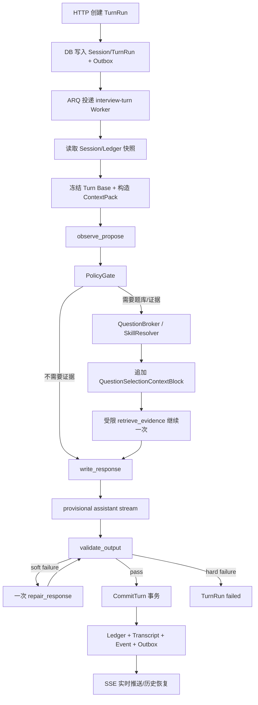

# 模拟面试 Agent Harness 2.0 整体 Spec

日期：2026-08-24
状态：设计冻结，Harness 2.0 P0 已落地；Eval/完整审计回放仍待实施
Harness 版本：`interview-harness@2.0`
适用范围：模拟面试实时对话、运行轨迹、SSE 恢复、Reasoning 展示、编辑重发和 Eval

## 1. 一页结论

模拟面试不是开放式聊天，而是一个有生命周期、题目覆盖、阶段约束、可恢复运行轨迹和正式事实提交边界的产品流程。因此 Harness 2.0 采用：

```text
确定性 Harness 负责业务状态、权限、预算、事件、恢复和提交
单一 interview-agent 负责受约束的观察、提案、写作和校验
QuestionBroker / SkillResolver 在模型外提供题目和 Skill 上下文
Bounded ReAct 只负责有界证据补充
SSE 负责把不可变运行轨迹实时投影给前端
```

核心原则：模型可以提出观察和动作，但不能直接改变 Session、Ledger、阶段、正式 Transcript 或下一次调用模式。所有正式事实都必须经过 PolicyGate、Validator 和 CommitTurn。

本 Spec 是实现入口；详细不可变事件、恢复、revision 和安全决策见 [ADR-0050](../../adr/0050-resumable-interview-turn-run-trace.md)。历史设计文档仍然保留，但不再覆盖本 Spec 中已经冻结的 Harness 2.0 合同。

## 2. 目标与非目标

### 2.1 目标

1. 面试官能够连续理解候选人回答，追问由证据缺口驱动，而不是由关键词机械触发。
2. 题库、Skill 和外部资料可以参与决策，但不能绕过业务约束或直接写入正式事实。
3. 每个 TurnRun 可暂停、取消、重试、恢复、编辑重发，并保留完整 Action、Attempt、Event、Reasoning 和 Artifact。
4. 前端能够像 DeepSeek/GPT 一样看到正在执行的动作、Reasoning、证据和临时回复，而不是等待黑盒结果。
5. 同一 TurnRun 内的上下文保持稳定前缀和冻结 Turn Base，只把新的动态内容追加到 Call Suffix，改善 Prompt Cache 命中和 Eval 可解释性。
6. Harness 2.0 可以通过 recorded replay、Golden Trace、Shadow Eval 和硬门槛持续评测。
7. 旧 Harness 1.0 会话保持原始 provenance，不补造 2.0 轨迹。

### 2.2 非目标

- 不引入 LangGraph、CrewAI 或其他框架作为强依赖；运行时仍是现有 FastAPI/Worker/数据库体系内的 Harness。
- 不把所有自然语言分支写成大量图节点或关键词规则。
- 不让 ReAct loop 直接生成最终用户回复或推进 Ledger。
- 不实现第二套 Redis/数据库 Prompt Cache。
- 设计冻结本身不要求删除旧路径或伪造历史数据；实现阶段按迁移策略逐步接入生产代码。

## 3. 总体架构



运行时分为四个边界：

| 边界 | 负责内容 | 不负责内容 |
| --- | --- | --- |
| Harness | 状态、权限、预算、路由、恢复、提交 | 自然语言表达 |
| Interview Agent | 观察、结构化提案、回复草稿、校验结果 | 直接写业务事实 |
| Evidence Services | 题目、Skill、外部证据 | 改变阶段或 Ledger |
| Projection | SSE、前端卡片、Reasoning/回答展示 | 重新执行 Agent |

## 4. 核心领域模型

系统只把以下四个对象作为本轮核心上下文来源；Action、Attempt、Event、Artifact 和 Outbox 是运行支撑对象，不替代这四个核心对象。

### 4.1 Session

Session 表示一次面试的长期配置和生命周期。

至少包含：

```text
session_id
owner_id / tenant_id
status
interview_config
language
difficulty
interview_mode
question_strategy
harness_version
provider / model policy
created_at / updated_at
```

Session 配置在 TurnRun 创建时复制进 Turn Base。中途修改只影响下一个 TurnRun，不能改变正在执行的回合。

### 4.2 Ledger

Ledger 是面试事实账本，不是完整聊天历史，也不是模型摘要。

至少维护：

```text
ledger_version
asked_question_refs
coverage_events
covered_dimensions
current_topic
current_phase
depth
closing_stage
counter_question_status
recent_rhythm_signals
```

Ledger 只由经过验证的 CommitTurn 更新。模型 observation、CoT、provisional assistant、检索结果和未提交题卡都不能推进 Ledger。

### 4.3 TurnRun

TurnRun 表示一次用户输入触发的完整可恢复运行。

至少包含：

```text
turn_run_id
session_id
client_request_id
user_message_id
revision_of_turn_id?
status
terminal_reason?
session_version
ledger_version_at_start
turn_run_version
current_action_id?
current_attempt_no?
latest_sequence
budget_snapshot
context_pack_hash
created_at / started_at / completed_at
```

正式执行终态为：

```text
completed
failed
cancelled
timed_out
budget_exhausted
```

`superseded` 只表示旧回合被编辑版本替代的关系/展示状态，不作为新的执行终态。

### 4.4 ContextPack

ContextPack 是针对某次 LLM 调用生成的临时输入视图，由三段组成：

```text
[Stable Agent Prefix]
[Turn Base: 当前 TurnRun 冻结]
[Call Suffix: 当前 Action 动态尾部]
```

ContextPack 不成为第五个长期领域对象；它的 hash、manifest 和 Artifact 用于审计、缓存观测和 Replay。

### 4.5 运行支撑对象

| 对象 | 作用 |
| --- | --- |
| Action | 一个语义动作，例如 observe、write、validate、commit |
| Attempt | 一个 Action 的实际执行尝试 |
| Event | 追加式、可恢复的运行事实 |
| Artifact | 原始响应、CoT、Prompt、Context 和调试材料 |
| Outbox | 数据库事务提交后向 SSE 发布的可靠中间记录 |

Action 状态固定为 `pending`、`started`、`streaming`、`waiting`、`completed`、`failed`、`cancel_requested`、`cancelled`。Attempt 状态固定为 `active`、`succeeded`、`failed`、`superseded`。

## 5. TurnRun 生命周期

### 5.1 创建

1. HTTP 接收 `client_request_id` 和用户输入。
2. 服务端校验 Session 所有权和当前是否允许创建回合。
3. 创建 UserMessage 和 TurnRun。
4. 读取当前 Session/Ledger 快照，生成 Turn Base 和预算快照。
5. 在同一事务中写入 TurnRun 初始状态、`turn.started` 事件和 Outbox。
6. 投递确定性 `turn_run_id` 到 ARQ 的 `interview-turn` queue。
7. 返回 `202` 和 `turn_run_id`，HTTP 请求不等待模型完成。

### 5.2 Worker 执行

Worker 领取 TurnRun 后获得租约，按 Action 边界推进状态。Worker 崩溃时：

```text
已完成 Action    -> 跳过
未确认 Action    -> 复用 action_id 重放
已失败 Action    -> 创建新 Attempt
已提交 CommitTurn -> 不重复提交
```

租约、心跳和恢复状态写入数据库；Redis/ARQ 只负责任务触发和有限重试，不是业务事实来源。

### 5.3 取消

`POST /turn-runs/{id}/cancel` 只写入 `cancel_requested`。Worker 在以下位置检查：

- 模型流式读取中；
- Action 完成、下一个 Action 启动前；
- Validator 完成、CommitTurn 开始前。

CommitTurn 进入数据库事务后不可取消。取消与提交使用条件更新，先成功者决定终态。

### 5.4 编辑与 revision

用户编辑旧输入时：

```text
旧 UserMessage / TurnRun -> 保留不可变轨迹
新 UserMessage / TurnRun -> revision_of_turn_id = 旧 turn_run_id
```

新回合重新构造 ContextPack，不复用旧回合的临时输出、Action 或 Attempt。旧回合不能再次提交 Ledger。

## 6. Interview Agent 合同

### 6.1 单一生产 Agent

生产运行时只有一个 `interview-agent`，通过固定调用模式执行不同语义动作：

```text
observe_propose
write_response
repair_response
validate_output
```

模型不能返回下一个 `call_mode`，也不能新增调用模式。调用模式由 Harness 根据状态和结构化结果选择。

### 6.2 固定流程

```text
observe_propose
  -> policy_gate
  -> retrieve_evidence（可选且最多一次继续）
  -> write_response
  -> validate_output
  -> commit_turn
```

一次模型调用只执行一个语义动作。`observe_propose` 可以在一次调用中同时产出 observation 和 proposal，但不能隐式推进后续业务阶段。

### 6.3 Response Envelope

所有调用统一返回：

```json
{
  "schema_version": "agent-result-v1",
  "call_mode": "observe_propose",
  "turn_run_id": "turn_...",
  "action_id": "action_...",
  "attempt": 1,
  "status": "completed",
  "payload": {},
  "usage": {},
  "provenance": {},
  "errors": []
}
```

`payload` 根据 `call_mode` 使用固定联合 Schema。解析失败时保存原始响应和错误，最多执行一次 Schema repair，不能把普通自然语言降级成动作。

### 6.4 ObservePropose

固定输出：

```text
answer_classification
observations
evidence_gaps
intent
proposed_action
question_strategy
risk_flags
confidence
```

动作使用固定枚举，例如：

```text
ask_followup
move_topic
clarify_answer
retrieve_question
skip_question
finish_interview
await_user_input
```

confidence 只影响继续、澄清或失败等路由，不能成为 Ledger 事实。

### 6.5 PolicyGate

PolicyGate 完全由代码执行，读取：

```text
Session config
Ledger snapshot
Agent proposal
QuestionBroker result
budget
safety and phase constraints
```

输出：

```text
allow
deny
repair
fallback
fail
```

冲突优先级固定为：

```text
安全与生命周期
  > 事实和题目绑定
  > 覆盖与面试配置
  > 自然度与表达风格
```

### 6.6 Writer 与 Validator

Writer 只返回：

```text
display_text
language
tone
question_count
question_ref
```

Writer 不能修改主题、深度、阶段、Ledger 或 QuestionCard。输出可在 Validator 和 CommitTurn 前以 provisional 形式流式展示，但不能视为正式 Transcript。

Validator 先执行确定性检查：

- Schema；
- 只有一个主要问题；
- QuestionCard 绑定；
- 主题和阶段边界；
- 内部信息泄露；
- 敏感字段；
- 长度和预算。

语义不确定时才允许一次窄范围 Validator 调用。问题使用 `code`、`severity`、`message`、`field`、`repairable` 字段。`soft_failure` 最多触发一次 repair，`hard_failure` 直接失败。

### 6.7 事实提交

只有以下内容可以进入 CommitTurn：

```text
validated_response
question_binding
ledger_patch
transcript_patch
turn_run_id
ledger_version
```

CommitTurn 采用 Ledger 乐观并发校验。事务成功后才依次形成正式 assistant Transcript、Ledger 更新、coverage event 和 `turn.completed`。

## 7. ContextPack 与 Prompt Cache

### 7.1 Stable Agent Prefix

只包含：

- 通用面试规则；
- 输出协议和固定 Schema；
- 隐私边界；
- 安全规则；
- 固定动作枚举；
- Harness 版本和 Prompt Schema 版本。

不得包含用户输入、Ledger、题目、Skill 正文、TurnRun、Action、时间戳或随机数。

### 7.2 Frozen Turn Base

TurnRun 创建时冻结：

- 本轮用户输入；
- Session 配置快照；
- Ledger 快照；
- 历史摘要；
- 初始 Skill 解析结果；
- 本轮预算。

同一 TurnRun 内不重新排序、裁剪、替换或压缩 Turn Base。历史摘要是带版本和 hash 的 Context Artifact，不是 Ledger 事实。

### 7.3 Call Suffix

所有本轮新增内容追加到 Call Suffix：

- 当前 Action；
- 当前阶段和题目；
- QuestionBroker 结果；
- evidence；
- Validator 反馈；
- repair 指令；
- 当前调用所需的动态约束。

同一 TurnRun 内旧 ContextBlock 不被覆盖，新 block 只追加 sequence。

### 7.4 Cache 身份

四种身份严格分离：

| 身份 | 作用 |
| --- | --- |
| `client_request_id` | HTTP 幂等 |
| `turn_run_id + action_id` | Action 恢复与重试 |
| `stable_prefix_hash` | 本地稳定前缀审计 |
| `provider_prompt_cache_key` | Provider 缓存路由 |

实际 Prompt/KV Cache 由 Provider 管理。缓存未命中只影响成本和延迟，不改变 TurnRun、Ledger、SSE、ARQ 或 CommitTurn 结果。相同 attempt 固定 Provider/model；fallback 创建新 attempt 并重新计算 hash/key。

## 8. QuestionBroker、SkillResolver 与 Bounded ReAct

### 8.1 QuestionBroker

QuestionBroker 在模型外运行，只有以下情况触发：

- 需要题库绑定；
- 需要覆盖明确维度；
- 必须换题；
- PolicyGate 要求权威题卡。

它返回带来源、选择理由、约束命中和权威校验的候选集或最终 QuestionCard。后端确定性选择一张最终题卡，完整候选集进入受保护审计轨迹。

最终题卡通过 `QuestionSelectionContextBlock` 追加到同一 TurnRun 的 ContextPack：

```text
question_ref
canonical_text
allowed_focus
forbidden_focus
selection_reason
source
authority_check
```

题卡只有在 Writer、Validator 和 CommitTurn 全部成功后才进入 Ledger 正式已问事实。

### 8.2 SkillResolver

SkillResolver 在模型外确定性选择 Skill。每个 Skill 必须有：

```text
skill_key
skill_version
harness_compatibility
content_hash
```

Skill 可以提供面试风格、追问模式、评估焦点和表达约束，但不能修改 Ledger、推进阶段、授权工具或绕过 PolicyGate。

### 8.3 Bounded ReAct

ReAct 只负责受控证据探索：

- 可以分析当前回答；
- 可以请求 QuestionBroker、SkillResolver 或受控外部证据；
- 题目结果注入后最多继续一次；
- 不能直接产生最终用户话术；
- 不能自行改变 `call_mode`、阶段或 Ledger；
- 工具和 evidence 有大小、深度、次数和预算上限。

Harness 2.0 不根据状态动态增删模型工具；模型工具 Schema 固定，QuestionBroker、SkillResolver 和 PolicyGate 不作为模型自由工具暴露。

## 9. 安全与可信边界

Context 来源优先级固定为：

```text
Harness/System
  > Session config
  > PolicyGate constraints
  > Skill constraints
  > QuestionCard
  > candidate_input
  > model explanation
```

候选人输入、题库、岗位描述、Skill、外部资料和 Provider 工具结果都必须标注来源。它们只能提供内容或 evidence，不能授权工具、改变阶段、修改 Ledger 或覆盖系统规则。

Evidence block 限制最大字节数、嵌套深度、条目数、引用数和注入次数；超限显式失败。租户私有 Skill、题库、岗位资料和 Prompt 不得进入全局 Prompt Cache 或其他租户 ContextPack。

`raw_provider_response`、原始 CoT 和完整 Prompt 加密保存，严格权限访问。SSE 只发送脱敏后的用户投影。响应分三层保存：

```text
raw_provider_response
normalized_agent_result
user_visible_projection
```

Prompt Injection 必须进入 Eval，覆盖候选人、题库、Skill、工具结果、岗位描述、跨 TurnRun 和跨租户场景。

## 10. 事件、SSE 与前端体验

### 10.1 持久化顺序

数据库事务同时写入：

```text
运行状态快照
业务事件
必要的 Ledger/Transcript 变更
Outbox
```

事务提交后由 Outbox Publisher 推送 SSE。事件表只追加，`(turn_run_id, sequence)` 唯一。Heartbeat 不写业务事件表、不占 sequence。

### 10.2 SSE Envelope

```json
{
  "event_id": "evt_...",
  "session_id": "session_...",
  "turn_run_id": "turn_...",
  "sequence": 42,
  "type": "reasoning.delta",
  "channel": "reasoning",
  "action_id": "action_...",
  "phase": "observe_propose",
  "occurred_at": "2026-08-24T00:00:00Z",
  "schema_version": "turn-event-v1",
  "payload": {}
}
```

至少注册：

```text
turn.started
action.started
action.updated
reasoning.delta
assistant.started
assistant.delta
assistant.completed
validation.failed
commit.started
commit.completed
turn.completed
turn.failed
turn.cancelled
turn.timed_out
```

Reasoning 与 Assistant 使用独立 channel 和 action_id，共享全局 sequence。每个 delta 携带稳定去重信息，前端按 event_id 或 `(action_id, channel, delta_index)` 去重。

### 10.3 恢复

支持：

```text
Last-Event-ID
after_sequence
GET /turn-runs/{id}/events?after_sequence=n
```

SSE 断开不取消后台 Worker。缺失或乱序事件由前端暂存，重连后按数据库 sequence 补齐。旧 TurnRun 的晚到事件不能进入新 TurnRun reducer。

### 10.4 前端运行卡片

```text
TurnRun 顶层卡片
  └── Action 卡片
       ├── Reasoning
       ├── Evidence
       └── Output
```

运行中自动展开当前 Action，前一 Action 自动折叠；用户手动展开状态优先。整轮完成后顶层卡片折叠，显示总耗时；点击耗时卡片可展开完整运行内容。CoT 使用最大高度和内部滚动。

Provisional assistant 显示“生成中/待校验”，CommitTurn 成功后变成正式回复。前端提供：

- 停止生成 → 正在停止 → 已停止/已完成；
- 编辑旧输入并创建 revision；
- SSE 重连状态；
- 可重试、可编辑重发、超时、预算耗尽和系统失败入口。

## 11. Eval、Replay 与发布

### 11.1 硬门槛

- 越权工具调用为零；
- Prompt 泄露为零；
- Ledger 污染为零；
- 非法阶段切换为零；
- 错误题目绑定为零；
- 未校验回复不得进入正式 Transcript。

### 11.2 软指标

```text
question_binding_rate
ledger_correctness
policy_compliance_rate
duplicate_question_rate
coverage_progress
repair_rate
hard_failure_rate
first_token_latency
turn_completion_latency
sse_recovery_success_rate
```

指标定义随 Harness 版本冻结。

### 11.3 Golden Trace 与 Replay

Golden Trace 必须覆盖正常回答、不完整回答、偏题、拒答、跳题、结束、多语言、题库无结果、Provider 超时、Schema 错误、Prompt Injection、编辑重发和 SSE 恢复。

`recorded_replay` 直接读取已保存的 Provider 原始响应和工具结果，不重新调用模型。运行前校验 Harness、Prompt/Schema、Skill、ContextPack、Provider/model 和 sampling hash；关键 hash 不匹配时标记为不可比对。

Judge 与生产 Interview Agent 分离，只读取正式 Transcript、Ledger 和事件。Judge 可以评价 CoT，但结构化 Action、PolicyGate、Validator、CommitTurn 和正式 Transcript 优先于 CoT。

### 11.4 发布

发布必须同时满足：

```text
功能
安全
一致性
体验
质量
```

Harness、Prompt、Skill、Provider、model、sampling 或 reasoning 能力发生变化时，必须重新运行关键 Golden Trace。Shadow Eval 只能读，不得写入正式 Ledger、Transcript 或用户 SSE。核心指标回归时禁止扩大灰度。

## 12. API 与数据边界

建议实现以下生命周期 API：

```text
POST /turn-runs
GET /turn-runs/{id}
GET /turn-runs/{id}/events
POST /turn-runs/{id}/cancel
POST /turn-runs/{id}/revisions
```

数据库至少需要保证：

```text
(turn_run_id, sequence)
(turn_run_id, action_id)
(action_id, attempt_no)
(turn_run_id, client_request_id)
```

ARQ 只触发和重试 Worker；数据库保存权威状态、事件、Action 和 Attempt；Redis 不形成第二套业务队列事实。

## 13. 迁移策略

### 阶段 0：冻结可观察事实

- 记录现有 ReAct、题库、Skill、Prompt、Provider 和事件事实；
- 确认旧会话 provenance；
- 建立 Golden Trace 和 recorded replay 基础。

### 阶段 1：建立新领域边界

- 建立 Session、Ledger、TurnRun、ContextPack 的读模型/写边界；
- 建立 Action、Attempt、Event、Artifact、Outbox；
- 先接入 deterministic PolicyGate、CommitTurn 和事件恢复。

### 阶段 2：接入 Agent 合同

- 实现固定 response envelope 和四种 call mode；
- 将 QuestionBroker、SkillResolver 接到服务端适配边界；
- 把 ReAct 限制为 bounded evidence continuation；
- 引入稳定前缀、冻结 Turn Base 和 Call Suffix。

### 阶段 3：SSE 与前端切流

- 接入事务性 Outbox、SSE sequence 恢复和 delta 去重；
- 上线 TurnRun 双层折叠卡片、Reasoning/Assistant 双通道、停止和编辑；
- Shadow Eval 对比旧路径和 Harness 2.0。

### 阶段 4：灰度与旧路径收敛

- 按租户、Session、Provider/model 和 Harness 版本灰度；
- 新回合逐步切换 2.0；
- 旧会话保持原 provenance；
- 达到发布门槛后再删除旧路径中的重复状态和隐藏副作用。

## 14. 当前实现状态

本节区分“已经进入代码主路径”和“仍是后续交付”，避免把设计合同误读为全部功能已经完成。

| 领域 | 当前状态 | 代码事实 |
| --- | --- | --- |
| Session / Ledger / TurnRun / ContextPack | P0 已落地 | `chat_conversations`、`interview_ledgers`、`chat_turns` 和 ContextPack builder 已接入；Ledger 只在正式完成事务中更新 |
| 单一 Agent 与固定调用模式 | P0 已落地 | `observe_propose`、`write_response`、`repair_response`、`validate_output` 由 Harness 选择，模型不能返回下一模式 |
| QuestionBroker / SkillResolver / Bounded ReAct | P0 已落地 | 题卡由后端确定性绑定，并作为 Call Suffix 注入；ReAct 工具调用有边界 |
| HTTP 202 / ARQ / DB lease / heartbeat | P0 已落地 | 明确 `harness_version=2.0` 的新请求先持久化再排队；DB 是权威状态，ARQ 是触发器 |
| Action / Attempt / Artifact / Event / Outbox | P0 已落地 | 事件和 Artifact 追加式保存；Provider 请求/响应在具备生产密钥时加密保存 |
| SSE 重放与前端双层运行卡片 | P0 已落地 | 支持 `after_sequence`、标准 `Last-Event-ID`、断线 follow、Reasoning/Assistant 双通道、停止和 revision |
| 事务性 CommitTurn | P0 已落地 | Harness 2.0 的正式消息、Ledger、assistant/commit/turn 完成事件同事务提交 |
| Recorded Replay / Golden Trace / Shadow Eval | 未完成 | 现有 Eval 可以驱动生产 pipeline，但尚未形成按 Context/Provider Artifact 校验 hash 的 Harness replay runner |
| 完整 Worker 安全边界恢复 | 部分完成 | 已完成租约、Attempt 复用和终态幂等；“从最近已完成 Action 跳过并重建全部临时投影”的端到端故障矩阵仍需补测 |
| Outbox 外部发布与细粒度权限投影 | 部分完成 | Outbox 已事务落库，SSE 当前直接读取授权事件表；独立 publisher、Artifact 读取 API 和更细的审计授权仍需补齐 |

因此，当前版本可以作为 Harness 2.0 P0 的开发基线和本地集成基线；在 Eval/Replay、完整故障矩阵和生产审计权限完成前，不应宣称已经满足全部发布门槛。

## 15. 验收清单

### Agent

- [ ] 只有一个生产 `interview-agent`。
- [ ] 调用模式和 payload Schema 固定。
- [ ] 模型不能控制下一模式、阶段或 Ledger。
- [ ] PolicyGate、Validator、CommitTurn 边界可审计。
- [ ] provisional 输出不会冒充正式 Transcript。

### Context 与 Cache

- [ ] Stable Prefix、Frozen Turn Base、Call Suffix 三段顺序稳定。
- [ ] 同一 TurnRun 内旧 ContextBlock 不重排或覆盖。
- [ ] `stable_prefix_hash` 和 `provider_prompt_cache_key` 身份分离。
- [ ] Provider fallback 创建新 Attempt。

### 持久化与恢复

- [ ] Event、Action、Attempt、Artifact 追加式保存。
- [ ] DB、Event、Ledger/Transcript 和 Outbox 事务一致。
- [ ] Worker 崩溃、ARQ 重试、取消和提交竞态可恢复。
- [ ] 编辑创建新 revision，不覆盖旧 TurnRun。

### SSE 与前端

- [ ] SSE 支持 Last-Event-ID、after_sequence 和历史回放。
- [ ] delta 可去重，乱序可恢复，旧回合不会污染新回合。
- [ ] 双层运行卡片、Reasoning/Assistant 通道和 CoT 高度限制完成。
- [ ] 停止、编辑、重连和失败入口符合状态机。

### Security 与 Eval

- [ ] 不可信输入和 Evidence 来源隔离。
- [ ] 租户私有上下文不进入全局 Cache。
- [ ] Prompt Injection Golden Trace 通过。
- [ ] 原始响应加密、SSE 前置脱敏和权限隔离完成。
- [ ] 关键环境变化可触发 Replay 和 Golden Trace 重测。

## 16. 设计冻结规则

本 Spec、ADR-0050 和 Harness 2.0 版本号共同构成实现合同。设计确认后不再通过新增字段或新增 Agent 来解决局部问题；实现中若发现冲突，必须：

1. 先记录现有代码事实和冲突位置；
2. 判断是否违反本 Spec 的核心边界；
3. 优先通过适配层、事件或 ContextBlock 解决；
4. 只有跨模块且无法兼容时，才新增 ADR 并更新 Harness 版本。

实现阶段的下一个交付物应是按数据模型、API、Harness Worker、SSE/Outbox、前端运行卡片和 Eval 分组的实施计划，而不是继续扩展架构抽象。
